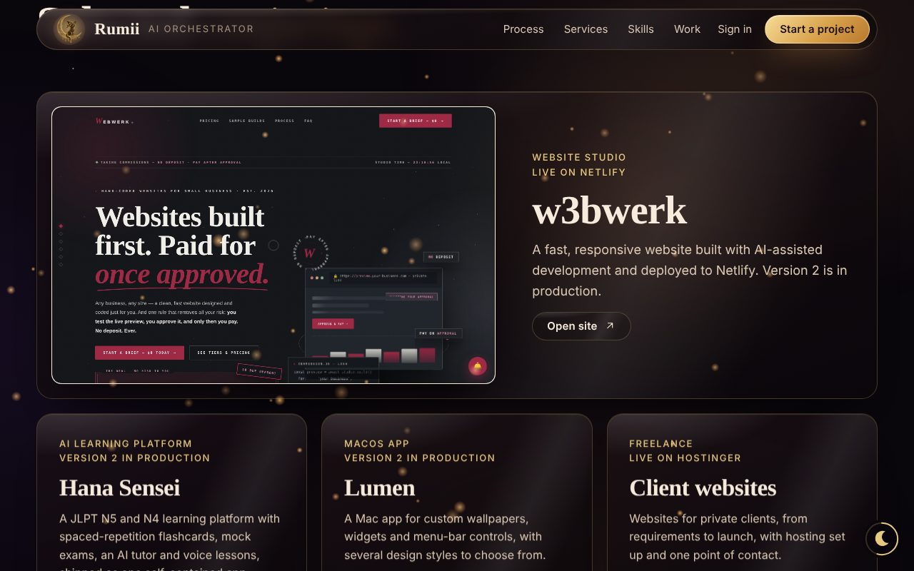
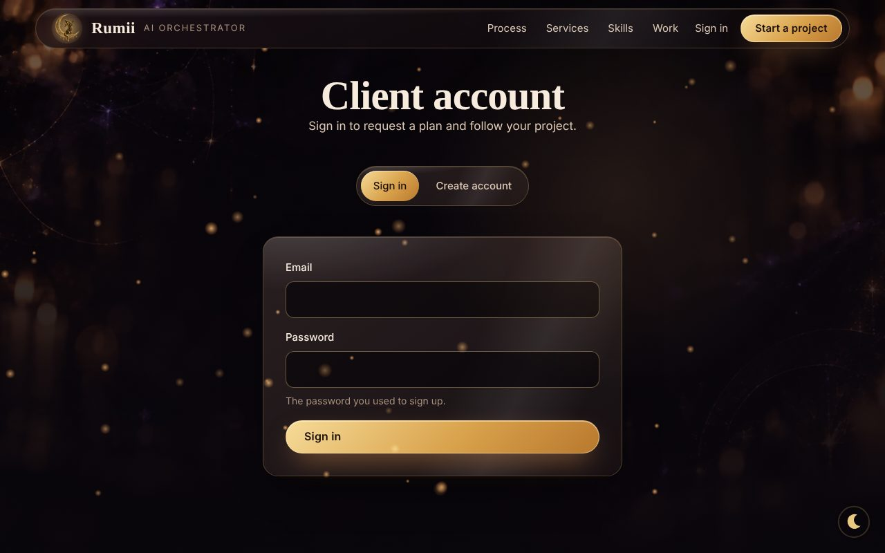

# Rumii — AI Orchestrator studio site

A one-page website for a one-person AI studio (websites, AI agents, knowledge engines, product sprints), with a **client portal** and an **admin dashboard** backed by Supabase. No framework and no build step: plain HTML, CSS and JavaScript, deployed on Netlify.

**Live site:** https://cappybara.netlify.app


| Selected work | Client portal |
|---|---|
|  |  |

## Features

- **Marketing site:** animated hero, service cards with plans and pricing, process, selected work, FAQ, responsive layout, SEO tags, Open Graph image, sitemap.
- **Client portal (`#/account`):** clients sign up, send a project request, track its status and exchange messages with the studio.
- **Admin dashboard (`#/admin`):** edit all site text, services, prices, skills and projects; read the inbox; reply to clients; change request status; upload pictures (resized in the browser before upload).
- **Publish flow:** admin edits are saved as JSON in Supabase and published to all visitors.
- **Netlify Forms backup:** new requests and messages are also posted to Netlify Forms, so nothing is lost if the database is unreachable.
- **Spam protection on the request form:** a hidden honeypot field and a 30-second limit per browser.
- **Optional email alerts:** a Supabase Edge Function that emails the owner on new requests and messages (see [Email notifications](#email-notifications)).

## Tech stack

- **Front end:** HTML, CSS and vanilla JavaScript, split into `index.html`, `styles.css`, `js/supabase.js` and `js/app.js`.
- **Supabase:** Postgres, Auth (email and password), Storage, Row Level Security, Edge Functions (TypeScript on Deno) and Database Webhooks.
- **Netlify:** static hosting and Forms.
- **Resend:** email delivery for the optional notifications.

## How it's built

```
                         Browser (index.html + styles.css + js/)
                                      |
        +-----------------------------+------------------------------+
        |                             |                              |
  Supabase Auth              Supabase REST API               Netlify Forms
  (sign up, sign in)        (Postgres + Row Level            (backup copy of
        |                    Security on every table)         requests/messages)
        |                             |
        +-------------+---------------+
                      |
          tables: site_content, inbox, requests, messages, admins
          storage: site-images (public read, admin write)
                      |
          INSERT on requests / messages
                      |
            Database Webhook (secret header)
                      |
          Edge Function notify-owner  --->  Resend  --->  owner's inbox
```

The browser talks to Supabase directly over its REST and Auth APIs. The only key in the page is the Supabase **publishable (anon) key**, which is designed to be public. All access control is enforced in the database with Row Level Security, not in the front-end code:

| Table | Visitors | Signed-in client | Admin |
|---|---|---|---|
| `site_content` | read | read | read, insert, update |
| `inbox` | insert (size-limited) | insert | read |
| `requests` | none | create and read own | read all, update status, delete |
| `messages` | none | read and send on own requests | read and send on all |
| `admins` | none | read own row | read own row |
| Storage `site-images` | read (public bucket) | none | upload, update, delete |

Admin rights come from a row in the `admins` table, checked by a `security definer` function (`is_admin()`), so a user cannot make themselves admin from the browser.

## Project structure

```
index.html                  page markup and the Netlify Forms stubs
styles.css                  all styles
js/supabase.js              Supabase config, auth and REST helpers, picture upload
js/app.js                   site logic: routing, rendering, client portal, admin
assets/                     images; assets/w3bwerk/ is a live preview shown in "Selected work"
docs/                       README screenshots
supabase.sql                schema, Row Level Security policies, storage bucket
supabase-notify.sql         read-only checks for the email notifications
supabase/functions/notify-owner/
                            Edge Function (index.ts) and a sample webhook payload
robots.txt, sitemap.xml     SEO
```

## Run it yourself

1. Create a free project at [supabase.com](https://supabase.com).
2. In the SQL Editor, run `supabase.sql` (all three parts).
3. Authentication → Users → add your own user, then run the last commented line of `supabase.sql` with your email to make that user an admin. In Authentication → Providers → Email, turn off "Confirm email" if you want clients to sign in straight after signing up.
4. In `js/supabase.js`, set `SB_URL` and `SB_KEY` (Project Settings → API) to your project's URL and **publishable/anon** key. Never use the `service_role` key.
5. Deploy the folder to Netlify (drag it into app.netlify.com/drop), or serve it locally with any static server, for example `python3 -m http.server`.
6. Replace the domain in `robots.txt` and `sitemap.xml` with your own.

If `SB_URL` and `SB_KEY` are left empty, the site runs in a browser-only preview mode (data kept in `localStorage`). That mode is for previewing edits and is **not** secure.

## What I learned

- **Security belongs in the database.** With a static front end that talks to the database directly, hiding a button proves nothing. Row Level Security policies, plus a `security definer` admin check, are what actually protect each client's data.
- **Public keys and secret keys are different things.** The publishable key can sit in the page, but only because RLS is on. The `service_role` key must never leave the server, and the Edge Function only gets it from Supabase's runtime.
- **Webhooks need their own authentication.** A function that anyone can call is an open door, so the webhook sends a shared secret that the function checks before doing anything.
- **Splitting a single file safely.** Moving a 1,600-line page into separate CSS and JS files without changing behaviour needed careful ordering of scripts and a before-and-after check in a browser.

## Limitations

- The front end is plain JavaScript without a framework or automated tests, which keeps deployment simple but makes the code harder to test and extend.
- Spam protection on the public forms is client-side (honeypot and a time limit) plus a payload size limit in the database. A production site would add a CAPTCHA or server-side rate limiting.
- Client data refreshes by polling about every 15 seconds, not by realtime subscriptions.
- Email notifications are optional and need their own setup (below). The site works the same without them.

## Email notifications

Optional and set up separately from the site. When a client sends a new request or a new message, you get an email. The site works the same without it, and the front-end and the Row Level Security policies in `supabase.sql` are not changed by it.

### The flow

```
Client submits in the portal
  -> a row is inserted into public.requests or public.messages
  -> a Database Webhook (one per table, INSERT only) posts that row as JSON
  -> the Edge Function notify-owner checks the secret header, builds the email
  -> Resend delivers it to you (reply-to is the client's email)
```

1. **Insert.** The portal inserts the row exactly as before, as the signed-in client and under the same policies.
2. **Webhook.** Supabase fires after the insert is saved, so an email problem can never block or undo a client's submission. The call carries a secret in the `x-webhook-secret` header.
3. **Function** (`supabase/functions/notify-owner/index.ts`):
   - Rejects any call without the right secret (401).
   - Ignores everything except inserts on `requests` and `messages`.
   - Ignores messages with `from_admin = true`, so your own replies do not email you.
   - For a message, looks up the request to show the client's name and service. This runs on the server with the service role key that Supabase provides to Edge Functions. If the lookup fails, the email is still sent.
   - Escapes everything the client wrote before putting it in the email.
4. **Resend** sends the email to `NOTIFY_EMAIL`.

### Secrets

Set with `supabase secrets set` (or Dashboard, Edge Functions, Secrets). None of them appear in any file in this repo.

| Secret | Required | What it is |
|---|---|---|
| `RESEND_API_KEY` | yes | Resend API key (starts with `re_`). |
| `NOTIFY_EMAIL` | yes | Where notifications go. On Resend's free plan without a verified domain this must be the email you signed up to Resend with. |
| `WEBHOOK_SECRET` | yes | A long random string. The same value goes in the webhook's `x-webhook-secret` header. |
| `NOTIFY_FROM` | no | Sender, for example `Rumii <hello@yourdomain.com>`. Needs a domain verified in Resend. Default: `onboarding@resend.dev`. |
| `SITE_URL` | no | Used for the "Open admin" link. Default: `https://cappybara.netlify.app`. |

### Security

- The service role key never appears in the front-end or in this repo. It exists only inside Supabase's function runtime.
- The function is deployed with `--no-verify-jwt` because the site's public key is visible in the browser, so "has a valid Supabase key" would not keep strangers out. The shared `WEBHOOK_SECRET` does.
- Do not use the webhook form's "Add auth header with service key" button. It is not needed here.

### Set up in short

```bash
supabase login
supabase init                      # once, in the folder that contains index.html
supabase link --project-ref <your-project-ref>
supabase secrets set RESEND_API_KEY=re_xxx NOTIFY_EMAIL=you@example.com WEBHOOK_SECRET=<long random string>
supabase functions deploy notify-owner --no-verify-jwt
```

Then in the dashboard (Database, Webhooks) create two webhooks, one on `public.requests` and one on `public.messages`: event Insert only, type Supabase Edge Functions, function `notify-owner`, method POST, timeout 5000 ms, and an extra header `x-webhook-secret` with the same value as `WEBHOOK_SECRET`.

To test the function before creating the webhooks, post `supabase/functions/notify-owner/sample-request.json` to it with the secret header. A 200 means the email was handed to Resend.

### Limits and troubleshooting

- Resend's free plan allows 100 emails a day and 3,000 a month. Past the limit, Resend refuses and the function logs a 429.
- Sending to anyone other than your own Resend sign-up email needs a verified domain. A 403 from Resend with "You can only send testing emails to your own email address" means `NOTIFY_EMAIL` is a different address.
- Function logs: Dashboard, Edge Functions, `notify-owner`, Logs. `supabase-notify.sql` has two read-only queries that show the installed triggers and what each webhook call returned.
- The Netlify Forms backup in the front-end is separate and unchanged.

